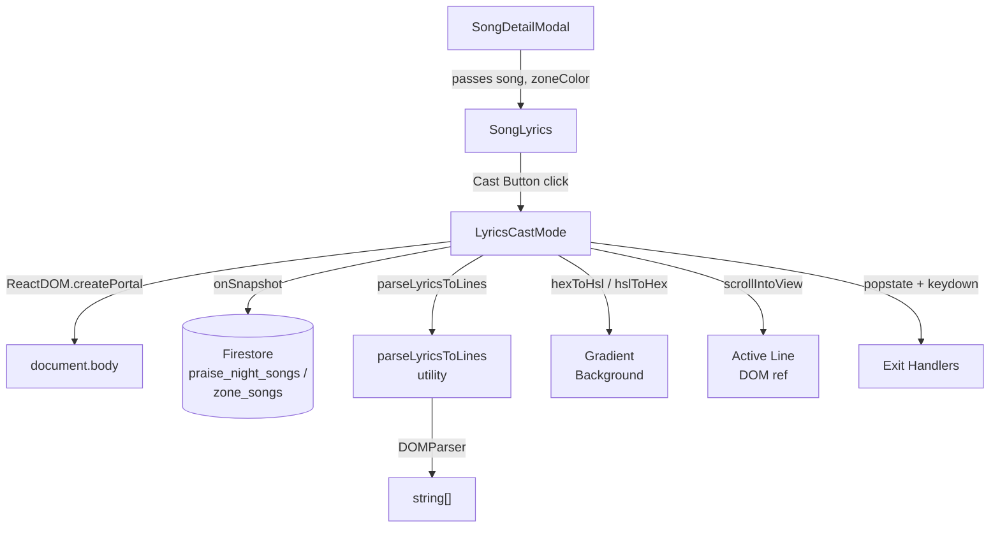

# Design Document: Lyrics Cast Mode (TV Mode)

## Overview

Lyrics Cast Mode is a full-screen, Spotify-like karaoke lyrics display launched from within the existing Song Detail Modal. When a rehearsal coordinator casts or mirrors the portal to a TV or projector, choir members need to read lyrics from a distance. Cast Mode fills the entire viewport with large, bold, white lyric text rendered on a vibrant gradient background derived from the zone's theme color — a clean, distraction-free experience.

The feature is built entirely within the existing React/Next.js App Router codebase. It adds one new component (`LyricsCastMode`), one new utility function (`parseLyricsToLines`), and a small cast button into the existing `SongLyrics` lyrics tab panel. No new routes, pages, or Firestore collections are needed.

**Key design goals:**
- Zero-latency launch — Cast Mode renders as a portal over the existing page, not a route change
- Real-time lyrics sync — Firebase `onSnapshot` keeps lyrics live during rehearsal
- Safe browser back — intercepts `popstate` so the back gesture exits Cast Mode rather than navigating away
- Full keyboard + touch navigation for the active line
- Accessible at WCAG 2.1 AA contrast ratios on any screen size

---

## Architecture



**Data flow:**
1. `SongDetailModal` already holds `selectedSong` (`PraiseNightSong`) and `zoneColor` (`currentZone?.themeColor`). These are passed down to `SongLyrics`.
2. `SongLyrics` renders the Cast Button. On click it sets `isCastModeOpen = true` in `SongDetailModal`.
3. `SongDetailModal` conditionally renders `<LyricsCastMode>` when `isCastModeOpen`. The component renders itself into `document.body` via `createPortal`.
4. Inside `LyricsCastMode`, a `useEffect` opens a Firestore `onSnapshot` listener scoped to the current song document. On every snapshot, lyrics are re-parsed with `parseLyricsToLines`.
5. Active line state lives in `LyricsCastMode` as `useState<number>`. Keyboard/touch/click handlers update it. A `useEffect` watching the active index fires `scrollIntoView`.

---

## Components and Interfaces

### `LyricsCastMode` Component

**File:** `src/components/song-detail/LyricsCastMode.tsx`

```typescript
interface LyricsCastModeProps {
  song: PraiseNightSong;          // Current song (initial snapshot)
  zoneColor: string;               // e.g. "#9333EA"
  zoneId: string;                  // For collection-name resolution
  onClose: () => void;             // Called by all exit paths
}
```

Internal state:
```typescript
const [lines, setLines] = useState<string[]>([]);
const [activeIndex, setActiveIndex] = useState<number>(0);
const [syncError, setSyncError] = useState<boolean>(false);
const [imgFailed, setImgFailed] = useState<boolean>(false);
const lineRefs = useRef<(HTMLButtonElement | null)[]>([]);
const containerRef = useRef<HTMLDivElement | null>(null);
const touchStartY = useRef<number | null>(null);
```

**Rendering via portal:**
```typescript
import { createPortal } from 'react-dom';

// In the return:
return typeof document !== 'undefined'
  ? createPortal(<CastModeUI />, document.body)
  : null;
```

The portal renders a `<div>` with:
- `position: fixed; inset: 0; z-index: 9999; overflow: hidden`
- `aria-label="Cast Mode Lyrics Display"`
- `tabIndex={-1}` (receives programmatic focus on mount)

**Visibility suppression of background UI:**
When Cast Mode mounts, it sets `document.body` style `overflow: hidden` and applies `aria-hidden="true"` to the `#__next` root element, preventing background elements from receiving focus. These are cleaned up on unmount.

---

### Cast Button integration into `SongLyrics`

The existing `SongLyrics` component already has a `Maximize2` (fullscreen) button. The Cast Button is added **inline in the tab content panel** (not as a floating button) so it is clearly associated with the Lyrics tab. It is placed 8px to the left of the existing Maximize button in the lyrics tab header row.

New prop added to `SongLyricsProps`:
```typescript
onOpenCastMode?: () => void;
```

Placement: inside the tab header row that currently only holds the `Maximize2` button, rendered as:
```tsx
{onOpenCastMode && (
  <button
    onClick={onOpenCastMode}
    aria-label="Cast / TV Mode"
    className="w-11 h-11 flex items-center justify-center rounded-full ..."
    style={{ minWidth: 44, minHeight: 44 }}
  >
    <Tv className="w-5 h-5" />
  </button>
)}
```

The `Tv` icon from `lucide-react` is used (it exists in the installed version). The two buttons are spaced `gap-2` (8px) apart.

---

### `parseLyricsToLines` Utility

**File:** `src/utils/lyrics-parser.ts`

```typescript
/**
 * Extracts an ordered array of non-empty plain-text lines from HTML lyrics.
 * Preserves non-whitespace characters byte-for-byte, including Unicode.
 */
export function parseLyricsToLines(html: string | null | undefined): string[] {
  if (!html) return [];

  // Step 1: Insert a newline sentinel after block-level closing tags
  // We handle both self-closing <br/> and paired </p>, </div>
  const withNewlines = html
    .replace(/<br\s*\/?>/gi, '\n')
    .replace(/<\/p>/gi, '\n')
    .replace(/<\/div>/gi, '\n');

  // Step 2: Use DOMParser to strip remaining tags and decode HTML entities
  // DOMParser is available in both browser and JSDOM (test environment)
  let plainText: string;
  if (typeof window !== 'undefined' && typeof DOMParser !== 'undefined') {
    const doc = new DOMParser().parseFromString(withNewlines, 'text/html');
    plainText = doc.body.textContent ?? '';
  } else {
    // SSR fallback: strip remaining tags with regex (no entity decoding needed server-side)
    plainText = withNewlines.replace(/<[^>]*>/g, '');
  }

  // Step 3: Split on newlines, trim each line, filter empty lines
  return plainText
    .split('\n')
    .map(line => line.trim())
    .filter(line => /\S/.test(line));
}
```

**Correctness guarantees:**
- `DOMParser` handles entity decoding (`&amp;` → `&`, `&nbsp;` → space, etc.) automatically via `textContent`
- Accented characters and non-Latin scripts are preserved because `textContent` returns the decoded Unicode string
- The newline-before-strip approach means block boundaries become line breaks before tag removal, preserving lyric line structure

---

## Data Models

### Zone / Theme Color

Sourced from `currentZone.themeColor` (a hex string, e.g. `"#9333EA"`) via `useZone()` → `zoneStore`. The `Zone` interface in `src/config/zones.ts` defines:

```typescript
interface Zone {
  id: string;
  name: string;
  slug: string;
  region: string;
  invitationCode: string;
  themeColor: string;   // hex color e.g. "#9333EA"
  streams?: StreamConfig[];
}
```

### PraiseNightSong (relevant fields)

```typescript
interface PraiseNightSong {
  id?: string;            // Firestore document ID
  title: string;
  writer?: string;
  lyrics?: string;        // HTML_Lyrics — stored as HTML markup
  imageUrl?: string;      // Optional artwork
  praiseNightId: string;  // Parent praise night / rehearsal session ID
  // ... other fields omitted
}
```

### Firestore Collection Paths

Songs live in one of two collections depending on zone type:

| Zone Type | Collection |
|---|---|
| HQ Groups (`isHQGroup(zoneId) === true`) | `praise_night_songs` |
| Zonal Groups | `zone_songs` |

The collection name is resolved by the existing `getCollectionName(zoneId)` helper in `praise-night-songs-service.ts`.

For the Cast Mode `onSnapshot`, the document reference is:
```typescript
import { doc, onSnapshot } from 'firebase/firestore';
import { db } from '@/lib/firebase-setup';
import { isHQGroup } from '@/config/zones';

const collectionName = isHQGroup(zoneId) ? 'praise_night_songs' : 'zone_songs';
const songRef = doc(db, collectionName, song.id!);
const unsubscribe = onSnapshot(songRef, (snap) => {
  if (snap.exists()) {
    const updated = snap.data() as PraiseNightSong;
    const newLines = parseLyricsToLines(updated.lyrics);
    setLines(newLines);
    // Active index preservation handled separately (see Req 7.3/7.4)
  }
}, (error) => {
  setSyncError(true);
});
```

The subscription is opened inside a `useEffect` with `song.id` and `zoneId` as dependencies, and the returned `unsubscribe` function is called in the cleanup.

---

### HSL Color Derivation for Background Gradient

The existing `darkenColor` in `SongDetailModal` uses raw RGB channel arithmetic, which can produce visually inconsistent results at extreme saturation. Cast Mode uses HSL manipulation for better visual quality:

```typescript
/**
 * Convert a hex color to HSL tuple [h, s, l].
 */
function hexToHsl(hex: string): [number, number, number] | null {
  const result = /^#?([a-f\d]{2})([a-f\d]{2})([a-f\d]{2})$/i.exec(hex);
  if (!result) return null;
  let r = parseInt(result[1], 16) / 255;
  let g = parseInt(result[2], 16) / 255;
  let b = parseInt(result[3], 16) / 255;
  const max = Math.max(r, g, b), min = Math.min(r, g, b);
  let h = 0, s = 0;
  const l = (max + min) / 2;
  if (max !== min) {
    const d = max - min;
    s = l > 0.5 ? d / (2 - max - min) : d / (max + min);
    switch (max) {
      case r: h = ((g - b) / d + (g < b ? 6 : 0)) / 6; break;
      case g: h = ((b - r) / d + 2) / 6; break;
      case b: h = ((r - g) / d + 4) / 6; break;
    }
  }
  return [Math.round(h * 360), Math.round(s * 100), Math.round(l * 100)];
}

function hslToHex(h: number, s: number, l: number): string {
  l /= 100; s /= 100;
  const a = s * Math.min(l, 1 - l);
  const f = (n: number) => {
    const k = (n + h / 30) % 12;
    const color = l - a * Math.max(Math.min(k - 3, 9 - k, 1), -1);
    return Math.round(255 * color).toString(16).padStart(2, '0');
  };
  return `#${f(0)}${f(8)}${f(4)}`;
}

/**
 * Derive the Cast Mode radial gradient background from zone theme color.
 * Returns a CSS background value string.
 * Falls back to '#1a1a2e' if the input color is invalid.
 */
export function deriveCastModeBackground(hexColor: string | null | undefined): string {
  const FALLBACK = '#1a1a2e';
  if (!hexColor) return FALLBACK;

  const hsl = hexToHsl(hexColor);
  if (!hsl) return FALLBACK;

  const [h, s, l] = hsl;
  // Lighter tint: increase lightness by 12, ensure minimum saturation
  const tintL = Math.min(l + 12, 60);
  const tint = hslToHex(h, Math.max(s, 60), tintL);
  // Darker shade: decrease lightness by 20, keep highly saturated
  const shadeL = Math.max(l - 20, 10);
  const shade = hslToHex(h, Math.max(s, 70), shadeL);

  return `radial-gradient(ellipse at 30% 20%, ${tint} 0%, ${hexColor} 45%, ${shade} 100%)`;
}
```

This function lives in `src/utils/lyrics-parser.ts` alongside `parseLyricsToLines`.

---

## Correctness Properties

*A property is a characteristic or behavior that should hold true across all valid executions of a system — essentially, a formal statement about what the system should do. Properties serve as the bridge between human-readable specifications and machine-verifiable correctness guarantees.*

**Property reflection:** After completing the prework analysis, the following redundancies were identified and resolved:
- 4.4 and 8.6 are the same property (keyboard navigation) — merged into Property 6
- 4.5 and 8.6 (up) are the same — merged into Property 7
- 1.4 and 8.5 both assert outside-UI suppression — merged into Property 3
- 2.7 and 4.6 both involve scrollIntoView on active line change — merged into Property 8
- 5.1, 5.2, 5.3, 5.4 are all facets of parser correctness — consolidated into Properties 10 and 11
- 7.3 and 7.4 together describe the complete active-line-preservation rule — consolidated into Property 14
- 3.6 and 6.3 and 6.4 together describe exit behavior — kept as separate properties because they test distinct behaviors (any-exit-closes, escape-closes, any-exit-resets-index)

---

### Property 1: Cast Mode suppresses background UI for any song

*For any* `PraiseNightSong` value, when `LyricsCastMode` is mounted, all portal root elements outside the Cast Mode container (specifically the `#__next` element) SHALL have `aria-hidden="true"` applied, so that screen readers and keyboard focus cannot reach background UI elements.

**Validates: Requirements 1.4, 8.5**

---

### Property 2: Background is derived from zone color for any valid hex input

*For any* valid CSS hex color string passed as `zoneColor`, `deriveCastModeBackground` SHALL return a CSS `background` string that contains a color value different from the fallback `#1a1a2e` and that encodes the hue of the input color.

**Validates: Requirements 2.2**

---

### Property 3: Fallback background applied for any invalid zone color

*For any* input to `deriveCastModeBackground` that is `null`, `undefined`, an empty string, or a string that is not a valid 6-digit hex color, the function SHALL return exactly `#1a1a2e`.

**Validates: Requirements 2.8**

---

### Property 4: All rendered lyric lines have font-weight 700

*For any* non-empty array of `Plain_Text_Lines`, every `<button>` element rendered for a lyric line SHALL have `font-weight: 700` (bold) applied via Tailwind `font-bold` or equivalent inline style.

**Validates: Requirements 2.5**

---

### Property 5: Active line scrolled into view on any index change

*For any* cast mode session with `N` `Plain_Text_Lines` where `N > 0`, when `activeIndex` changes to any value `i` in `[0, N-1]`, `lineRefs.current[i].scrollIntoView` SHALL be called with `{ behavior: 'smooth', block: 'start' }`.

**Validates: Requirements 2.7, 4.6**

---

### Property 6: Down arrow navigation advances to next non-empty line

*For any* `Plain_Text_Lines` array and any `activeIndex i` where a line `j > i` exists with non-whitespace content, pressing the `ArrowDown` key SHALL set `activeIndex` to the smallest such `j`.

**Validates: Requirements 4.4, 8.6**

---

### Property 7: Up arrow navigation moves to previous non-empty line

*For any* `Plain_Text_Lines` array and any `activeIndex i` where a line `j < i` exists with non-whitespace content, pressing the `ArrowUp` key SHALL set `activeIndex` to the largest such `j`.

**Validates: Requirements 4.5, 8.6**

---

### Property 8: Navigation clamps at last non-empty line

*For any* `Plain_Text_Lines` array, when `activeIndex` is already at the index of the last non-empty line, pressing `ArrowDown` (or performing an upward swipe ≥20px) SHALL leave `activeIndex` unchanged.

**Validates: Requirements 4.7**

---

### Property 9: Click on any line sets it as Active_Line

*For any* `Plain_Text_Lines` array and any line index `i`, clicking the button rendered for line `i` SHALL set `activeIndex` to `i`.

**Validates: Requirements 4.3**

---

### Property 10: parseLyricsToLines output contains no whitespace-only lines

*For any* HTML string passed to `parseLyricsToLines`, every element of the returned array SHALL satisfy `/\S/.test(line)` (contains at least one non-whitespace character).

**Validates: Requirements 5.2**

---

### Property 11: parseLyricsToLines preserves non-whitespace character sequences

*For any* HTML string `html` whose visible text content (as rendered by a browser) has a non-whitespace character sequence `S`, `parseLyricsToLines(html).join('')` with all whitespace removed SHALL equal `S` with all whitespace removed — preserving accented characters and non-Latin scripts byte-for-byte.

**Validates: Requirements 5.1, 5.3, 5.4**

---

### Property 12: Initial Active_Line is first non-empty line

*For any* `Plain_Text_Lines` array (including arrays with leading empty strings before filtering), when Cast Mode opens, `activeIndex` SHALL be initialized to `0` because `parseLyricsToLines` guarantees all entries are non-empty — so the first element is always the correct starting line.

**Validates: Requirements 4.1**

---

### Property 13: Exit via any method closes Cast Mode

*For any* open Cast Mode session triggered for any song, invoking any of the three exit paths (exit button click, `popstate` event while Cast Mode active, `Escape` keydown) SHALL result in `onClose()` being called exactly once.

**Validates: Requirements 3.6, 6.1, 6.2, 6.3**

---

### Property 14: Active line index resets to 0 on any close

*For any* Cast Mode session where `activeIndex` is at any value `i ≥ 0`, invoking any exit path SHALL reset the internal `activeIndex` state to `0` before `onClose()` is called (so the next session starts fresh).

**Validates: Requirements 6.4**

---

### Property 15: Omit writer line for any song with no writer

*For any* `PraiseNightSong` where `writer` is `null`, `undefined`, or an empty string, the Cast Mode header SHALL NOT render a writer text element (no empty `<p>` or placeholder label visible).

**Validates: Requirements 3.7**

---

### Property 16: Song thumbnail rendered at 56×56px for any song with imageUrl

*For any* `PraiseNightSong` where `imageUrl` is a non-empty string and the `` element does not fire an `error` event, the thumbnail SHALL be rendered with `width={56}` and `height={56}` (in pixels).

**Validates: Requirements 3.3**

---

### Property 17: Lyrics update preserves active index when within bounds

*For any* Cast Mode session where `activeIndex = i` and an updated `Plain_Text_Lines` array of length `L` is received from Firebase, if `i < L` then `activeIndex` SHALL remain `i` after the re-render; if `i >= L` then `activeIndex` SHALL be reset to `0`.

**Validates: Requirements 7.3, 7.4**

---

### Property 18: Root container has correct aria-label for any song

*For any* `PraiseNightSong` passed to `LyricsCastMode`, the root `<div>` rendered by the portal SHALL have `aria-label="Cast Mode Lyrics Display"`.

**Validates: Requirements 8.3**

---

## Error Handling

| Scenario | Behavior |
|---|---|
| `lyrics` is `null` / `undefined` / empty | `parseLyricsToLines` returns `[]`; Cast Mode renders "No lyrics available" placeholder at the same font size as lyric body text |
| `lyrics` yields only whitespace/entities after parsing | Same as above — `[]` → placeholder |
| `imageUrl` fails to load (`onError`) | `setImgFailed(true)` → render `<Music className="w-14 h-14" />` icon at 56×56px container |
| `imageUrl` absent | Render music note icon placeholder directly without attempting an `` element |
| Firebase `onSnapshot` error callback fires | `setSyncError(true)` → renders a small `<WifiOff>` icon badge in the top-right of the header with `title="Live sync unavailable"` |
| `zoneColor` is null/invalid hex | `deriveCastModeBackground` returns `#1a1a2e` fallback; this maintains ≥4.5:1 contrast with white text |
| `song.id` is undefined (edge case) | Skip `onSnapshot` subscription; display lyrics from the prop snapshot only (no live sync) |
| SSR / `document` not available | `createPortal` is guarded with `typeof document !== 'undefined'`; `parseLyricsToLines` uses regex fallback instead of `DOMParser` |

---

## Testing Strategy

### Unit Tests (example-based)

Framework: **Vitest** + **React Testing Library** (already in use in the project via Next.js).

Specific examples to cover:
- Cast Button renders with `aria-label="Cast / TV Mode"` and `min-width/height` of 44px
- Cast Mode root element has `aria-label="Cast Mode Lyrics Display"`
- `parseLyricsToLines` with `null` / `''` / `'<p>&nbsp;</p>'` returns `[]`
- `parseLyricsToLines` with `'<p>Line 1</p><p>Line 2</p>'` returns `['Line 1', 'Line 2']`
- `parseLyricsToLines` with `'Verse 1<br/>Line 2<br/>'` returns `['Verse 1', 'Line 2']`
- `deriveCastModeBackground(null)` returns `'#1a1a2e'`
- `deriveCastModeBackground('#xyz')` returns `'#1a1a2e'`
- `deriveCastModeBackground('#9333EA')` returns a string containing `radial-gradient`
- Clicking the exit button calls `onClose`
- Image `onError` renders music note fallback
- Song with no `writer` field does not render a writer element in the header

### Property-Based Tests

Framework: **fast-check** (install: `npm install --save-dev fast-check`).

Each property test runs a minimum of 100 iterations.

Tag format: `// Feature: lyrics-cast-mode, Property {N}: {property_text}`

**Property tests to implement:**

```
// Feature: lyrics-cast-mode, Property 10: parseLyricsToLines output contains no whitespace-only lines
fc.assert(fc.property(fc.string(), (html) => {
  const lines = parseLyricsToLines(html);
  return lines.every(line => /\S/.test(line));
}), { numRuns: 100 });

// Feature: lyrics-cast-mode, Property 11: preserves non-whitespace character sequences
fc.assert(fc.property(fc.array(fc.string({ minLength: 1 })), (words) => {
  const html = words.map(w => `<p>${w}</p>`).join('');
  const joined = parseLyricsToLines(html).join('').replace(/\s/g, '');
  const expected = words.join('').replace(/\s/g, '');
  // Only compare if words contain no HTML special chars (< > & ") for simplicity
  const safe = words.every(w => !/[<>&"]/.test(w));
  return !safe || joined === expected;
}), { numRuns: 100 });

// Feature: lyrics-cast-mode, Property 6: down arrow advances to next non-empty line
// (renders component in JSDOM, fires ArrowDown, asserts index change)

// Feature: lyrics-cast-mode, Property 7: up arrow moves to previous non-empty line

// Feature: lyrics-cast-mode, Property 8: navigation clamps at last non-empty line

// Feature: lyrics-cast-mode, Property 2: valid hex → non-fallback background
fc.assert(fc.property(fc.hexaString({ minLength: 6, maxLength: 6 }), (hex) => {
  const result = deriveCastModeBackground('#' + hex);
  return result !== '#1a1a2e';
}), { numRuns: 100 });

// Feature: lyrics-cast-mode, Property 3: invalid input → fallback
fc.assert(fc.property(
  fc.oneof(fc.constant(null), fc.constant(undefined), fc.constant(''), fc.string()),
  (bad) => {
    if (bad && /^#[0-9a-fA-F]{6}$/.test(bad as string)) return true; // skip valid
    return deriveCastModeBackground(bad as any) === '#1a1a2e';
  }
), { numRuns: 100 });

// Feature: lyrics-cast-mode, Property 17: Firebase update preserves/resets active index
// (unit test with controlled state transitions, 100 iterations with random index + array length pairs)
```

### Integration Tests

- Open `SongDetailModal` with a real (mocked) `PraiseNightSong` fixture, click Cast Button, assert Cast Mode overlay is present in `document.body` via `createPortal`
- Verify `FirebaseMetadataService.subscribeToSongMetadata` is called when Cast Mode opens and unsubscribed when it closes
- Simulate a Firestore `onSnapshot` callback with new lyrics data, assert the displayed lines update

### Accessibility Verification (manual)

Full WCAG 2.1 AA validation requires manual testing with assistive technologies and expert review. Automated checks cover:
- `aria-label` presence on root container (Property 18)
- `aria-label` on Cast Button (unit test)
- `aria-hidden` on `#__next` while Cast Mode is open (Property 1)
- Focus programmatically moved to root container on mount (unit test: `document.activeElement`)

Screen reader testing with VoiceOver (iOS/macOS) and TalkBack (Android) should be performed manually before release.
